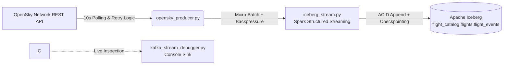

# ✈️ Real-Time Flight Telemetry Lakehouse (Kafka, Spark & Apache Iceberg)

**Status:** `Completed` | **Host:** `AlmaLinux (Self-Hosted)` | **Stack:** `Apache Kafka` • `Apache Spark` • `Apache Iceberg`


An end-to-end, fault-tolerant real-time data pipeline ingesting live ADS-B aircraft state vectors from the **OpenSky Network REST API**, streaming through **Apache Kafka**, processing via **Apache Spark Structured Streaming**, and persisting into an ACID-compliant **Apache Iceberg** lakehouse (`flight_catalog.flights.flight_events`) deployed self-hosted on **AlmaLinux**.

---

## 🏗️ System Architecture



### Engineering & Infrastructure Highlights
* **VMware / Self-Hosted AlmaLinux Deployment:** Built and tuned directly on a self-hosted **AlmaLinux** environment using local disk storage for the Iceberg warehouse and Spark checkpoints, avoiding managed cloud abstractions to maintain full control over JVM tuning, disk I/O, and resource allocation.
* **Ordered Ingestion (`opensky_producer.py`):** Polls live global aircraft telemetry and partitions messages in Kafka.
* **Backpressure & Micro-Batch Throttling (`iceberg_stream.py`):** Configures `maxOffsetsPerTrigger` (`30,000` records) and `30-second` processing intervals to prevent memory spikes on single-node deployments while maintaining fault-tolerant offset tracking via Spark checkpoints.
* **Stream Inspection Tooling (`kafka_stream_debugger.py`):** Decoupled console consumer with `10-second` micro-batch throttling for live schema validation and throughput debugging without impacting the primary Iceberg sink.

---

## 📂 Repository Structure

```text
├── producer/
│   └── opensky_producer.py          # OpenSky API ingestion & Kafka producer
├── streaming/
│   └── kafka_stream_debugger.py     # Throttled Spark console consumer for live stream debugging
├── lakehouse/
│   └── iceberg_stream.py            # Production Spark Structured Streaming sink to Apache Iceberg
├── requirements.txt                 # Python dependencies
├── .gitignore                       # Excludes local checkpoints, warehouse data & cache
└── README.md
```

---

## 🚀 Execution & Quickstart

### 1. Start the OpenSky Telemetry Producer
Ingests live flight state vectors every 10 seconds and publishes them to the `flights` Kafka topic:
```bash
python3 producer/opensky_producer.py
```

### 2. (Optional) Live Stream Debugging
Verify incoming JSON payloads and schema enforcement in real time:
```bash
spark-submit \
  --packages org.apache.spark:spark-sql-kafka-0-10_2.12:3.5.0 \
  streaming/kafka_stream_debugger.py
```

### 3. Run the Apache Iceberg Streaming Sink
Persist streaming micro-batches into the Iceberg lakehouse table (`flight_catalog.flights.flight_events`):
```bash
spark-submit \
  --packages org.apache.spark:spark-sql-kafka-0-10_2.12:3.5.0,org.apache.iceberg:iceberg-spark-runtime-3.5_2.12:1.5.0 \
  --conf spark.sql.extensions=org.apache.iceberg.spark.extensions.IcebergSparkSessionExtensions \
  --conf spark.sql.catalog.flight_catalog=org.apache.iceberg.spark.SparkCatalog \
  --conf spark.sql.catalog.flight_catalog.type=hadoop \
  --conf spark.sql.catalog.flight_catalog.warehouse=./warehouse \
  lakehouse/iceberg_stream.py
```

### 4. Analytical Query Example (Spark SQL)
Query the persisted Iceberg table with ACID consistency and snapshot isolation:
```sql
SELECT 
    origin_country,
    ROUND(AVG(baro_altitude), 2) AS avg_altitude_m,
    ROUND(AVG(velocity), 2) AS avg_velocity_ms
FROM flight_catalog.flights.flight_events
WHERE on_ground = false
GROUP BY origin_country
ORDER BY active_aircraft DESC
LIMIT 10;
```


---

## 🛠️ Environment & Version Compatibility

* **OS:** AlmaLinux (Self-Hosted)
* **Apache Spark:** `4.1.4` (Scala `2.13`)
* **Apache Iceberg:** `1.12.0` (`iceberg-spark-runtime` matched to Spark `4.1` / Scala `2.13` ABI; newer `4.2.13` builds introduce breaking catalog API changes with this Iceberg runtime)
* **Apache Kafka:** `4.3.1` (KRaft)


---

## ☁️ Production Scaling Roadmap (GCP Target Architecture)

While this implementation runs self-hosted on AlmaLinux with local disk storage for deterministic performance testing, the architecture is decoupled for seamless migration to **Google Cloud Platform (GCP)**:
* **Object Storage & Warehouse:** Migrate local Iceberg warehouse and Spark checkpoints to **Google Cloud Storage (GCS)** with lifecycle policies.
* **Catalog & Governance:** Transition from local Hadoop catalog to **Iceberg REST Catalog / BigLake Metastore** for multi-engine access (Spark, Trino, BigQuery).
* **Compute & Messaging:** Scale single-node Spark/Kafka to **Dataproc Serverless** and **Managed Service for Apache Kafka** (or Pub/Sub) with automated table compaction and snapshot expiration jobs.
